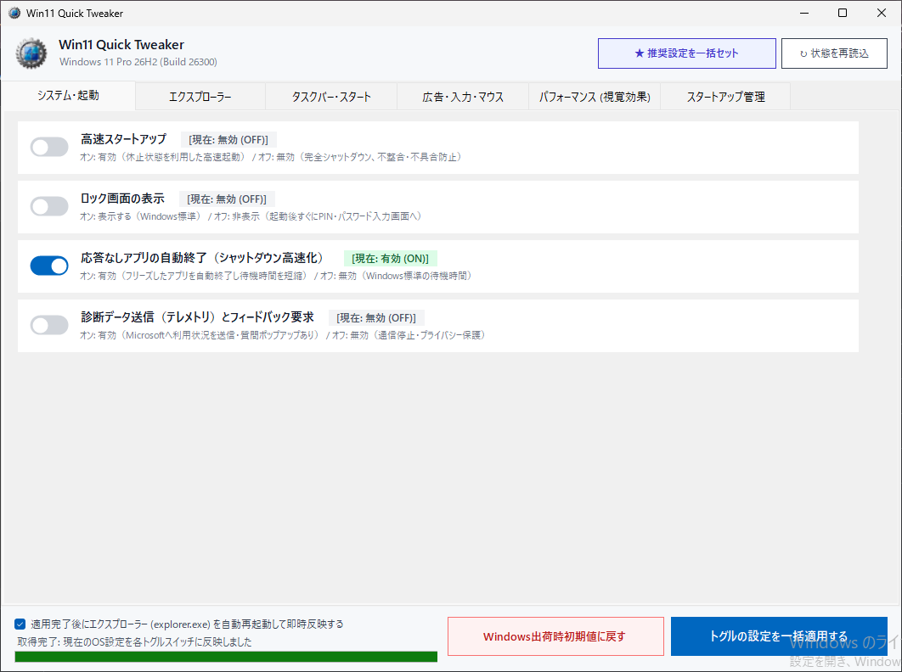
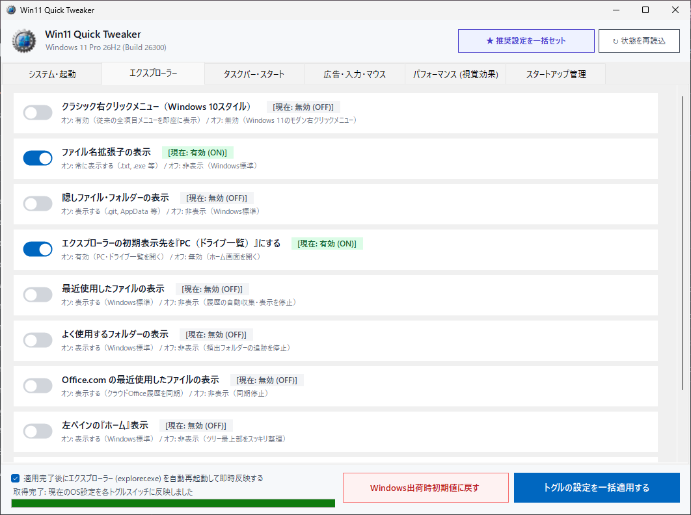
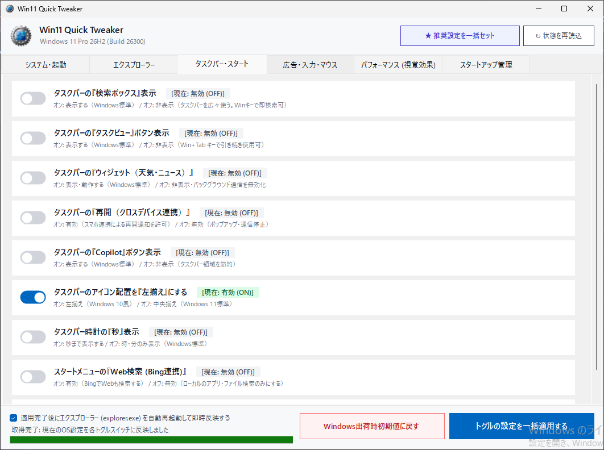
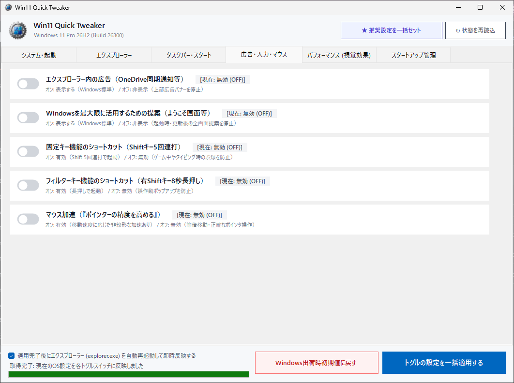
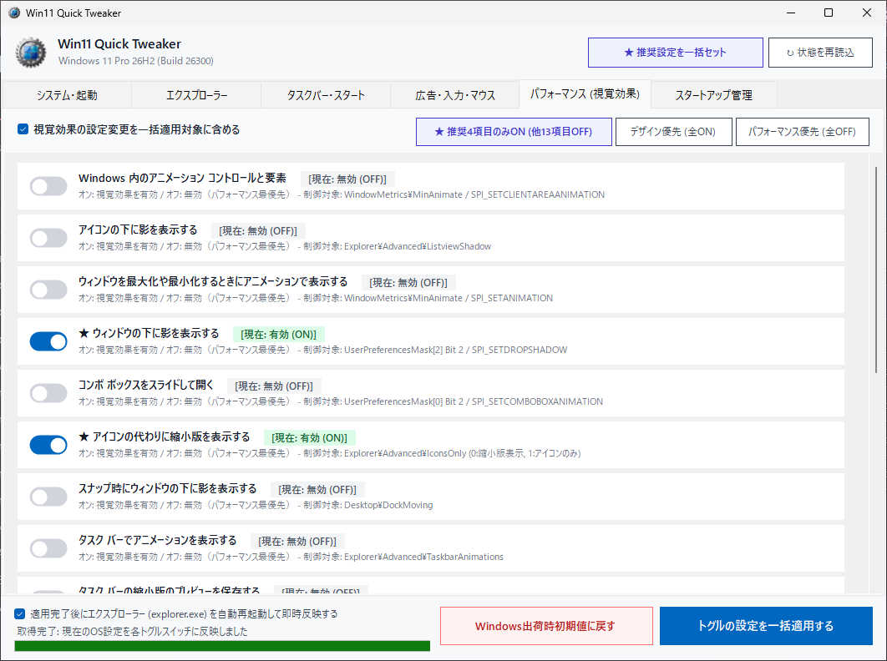
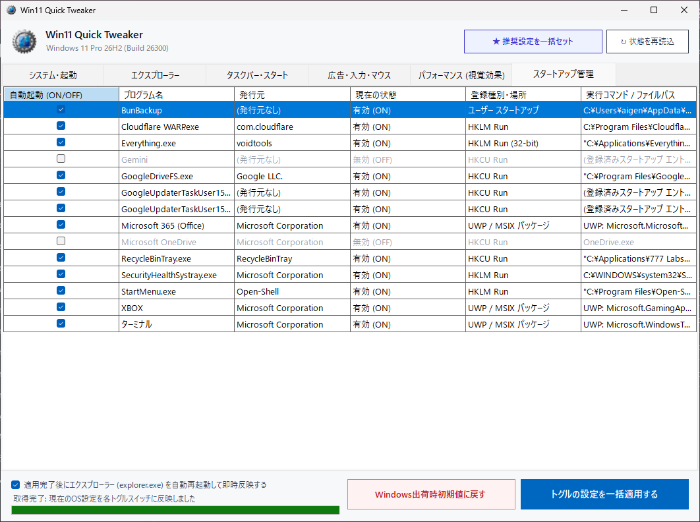

# Win11 Quick Tweaker

**Windows 11 の不要機能・広告・視覚効果・スタートアップを一括制御する高速最適化ツール**

[-0078D4?style=flat-square)](https://github.com/777Labs/win11-quick-tweaker)

[📥 最新版をダウンロード (Releases)]([https://github.com/777Labs/Win11QuickTweaker/releases/latest])

---

## 📸 スクリーンショット

---

## ✨ 主な特徴

- 🚀 **超高速・完全スタンドアロン**:
  - インストール不要のポータブル設計。単一の実行ファイル（`Win11QuickTweaker.exe`）だけで即座に起動します。
  - 外部NuGetパッケージ依存ゼロ。外部ライブラリ由来の不具合や脆弱性リスクを完全排除。
- 🔘 **直感的なトグルスイッチ式UI**:
  - すべての設定を「オン＝有効（表示） / オフ＝無効（非表示）」に統一。
  - 起動時に現在のOS設定値を自動取得し、各トグルスイッチへ即座に反映します。
- ⚙️ **充実のシステム・UI最適化（全28項目）**:
  - **システム・起動**: 高速スタートアップ、フリーズしたアプリの自動終了（シャットダウン高速化）、ロック画面の表示、診断データ送信（テレメトリ）の制御。
  - **エクスプローラー**: 拡張子表示、隠しファイル表示、コンパクト表示（行間を詰める）、チェックボックス非表示、ナビゲーションウィンドウ同期。
  - **タスクバー & スタート**: タスクバー配置（中央/左寄せ）、ボタンのまとめ機能、Copilot・ウィジェット・タスクビュー・チャットアイコンの非表示、スタートメニューのおすすめコンテンツ非表示。
  - **広告・おすすめ無効化**: 設定アプリの広告、エクスプローラーのOneDrive広告、スタートメニューのおすすめアプリ（プロモーション）、Windowsのヒント・おすすめ通知の完全ブロック。
- ⚡ **パフォーマンス (視覚効果) 精密制御（全17項目）**:
  - ウィンドウアニメーション、ドロップシャドウ、サムネイル表示など17項目を個別に制御可能。
  - 「デザイン優先 (全ON)」「パフォーマンス優先 (全OFF)」「★ 推奨4項目のみON」のワンクリックプリセットを完備。
- 📋 **タスクマネージャー完全互換 スタートアップ管理**:
  - Windowsタスクマネージャーの「スタートアップ アプリ」タブと完全に同一のプログラム名・発行元・登録種別で一覧表示。
  - Win32アプリに加え、**UWP / MSIX パッケージ（Copilot, PC Manager, ターミナル, XBOX 等）** の自動起動も包括的に制御可能。
- 🔄 **安心の初期値復元 ＆ 即時シェル反映**:
  - 「Windows出荷時初期値に戻す」ボタンで、いつでもワンクリックでOS初期状態に一括復元可能。
  - エクスプローラーのサイレント自動再起動により、サインアウト不要で設定を即座に反映します。

---

## 📥 ダウンロードと使い方

### 1. ダウンロード
右側の [**Releases**](https://github.com/777Labs/win11-quick-tweaker/releases) ページから最新の `Win11QuickTweaker_v1.0.0.zip`（または `Win11QuickTweaker.exe`）をダウンロードしてください。

### 2. 起動方法
1. ダウンロードした ZIP ファイルをお好みのフォルダーに展開（解凍）します。
2. 展開されたフォルダー内の `Win11QuickTweaker.exe` を右クリックし、「**管理者として実行**」します。
   - ※ レジストリを使用しないポータブル仕様のため、USBメモリなどに入れて持ち運ぶことも可能です。

---

> [!IMPORTANT]
> ### 🛡️ Windows SmartScreen 警告が出た場合
> インターネットから新しくダウンロードしたアプリを初めて起動する際、Windows によって「**Windows によって PC が保護されました**」という青い画面が表示される場合があります。
> 
> これは個人開発のフリーソフトにおいてデジタル署名が未知であるために表示される標準的なセキュリティ確認画面です。以下の手順でそのまま起動できます：
> 1. 画面内の「**詳細情報**」リンクをクリックします。
> 2. 右下に表示される「**実行**」ボタンをクリックします。
> （一度実行を許可すれば、次回以降はこの画面は表示されなくなります）

---

## 🗂️ 設定項目一覧

| カテゴリ | 主な最適化項目 |
| :--- | :--- |
| **システム・起動** | 高速スタートアップ、フリーズしたアプリの自動終了、ロック画面表示、診断データ送信 (テレメトリ) |
| **エクスプローラー** | ファイル拡張子の表示、隠しファイル・フォルダーの表示、コンパクト表示、チェックボックス非表示、ナビゲーションウィンドウ同期 |
| **タスクバー・スタート** | タスクバーの配置 (中央/左寄せ)、タスクバーボタンのまとめ、Copilot / ウィジェット / タスクビュー / チャット非表示、おすすめコンテンツ非表示 |
| **広告・入力・マウス** | 設定アプリ内の広告、エクスプローラー内のOneDrive広告、スタートメニューのプロモーションアプリ、Windowsのヒント・おすすめ通知の完全ブロック |
| **パフォーマンス (視覚効果)** | アニメーション、ドロップシャドウ、サムネイル表示、フォントのスムーズエッジ等 17項目の個別トグル & 3種のワンクリックプリセット |
| **スタートアップ管理** | Win32 / UWP / MSIX アプリの自動起動一括制御 (タスクマネージャー完全一致の名前・発行元表示) |

---

## 💻 動作環境

- **OS**: Windows 11 (64-bit / x64) ※バージョン 21H2 以降
- **権限**: 管理者権限（UACプロンプトが表示されます）
- **ランタイム**: 不要（必要な実行エンジンが exe に内包されているため、追加の .NET インストールは不要です）

---

## 📄 利用規約・ライセンス

本ソフトウェアは **無料（フリーウェア）** として提供されています。個人利用・商用利用を問わず、どなたでも無償でご利用いただけます。
詳細については [LICENSE](LICENSE) をご確認ください。

Copyright (c) 2026 777Labs / Win11QuickTweaker All rights reserved.
